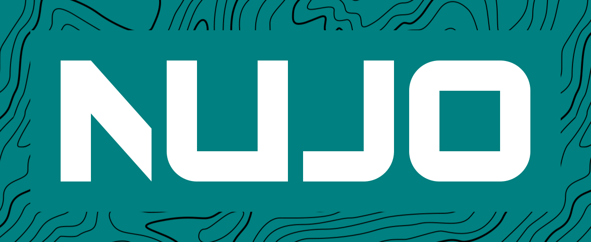

<div align="center">



# Nuvo-OS

**An open-source operating system.**

[](LICENSE)
[](CHANGELOG.md)
[](https://github.com/ercogu/Nuvo-OS/commits/main)
[](https://github.com/ercogu/Nuvo-OS/issues)

**English** · [Русский](README.ru.md)

</div>

---

## About

Nuvo-OS is a free and open-source operating system developed in the open under the GNU GPL v3.

## Status

Nuvo-OS is in **early development**. There are no stable releases yet, and everything may change without notice. Follow progress in the [changelog](CHANGELOG.md).

## Getting started

```bash
git clone https://github.com/ercogu/Nuvo-OS.git
cd Nuvo-OS
```

The build environment (cross-compiler, NASM, QEMU, make, git) is provided as a Docker image, so the only thing you need on your host is [Docker](https://docs.docker.com/engine/install/).

```bash
# build the image once (downloads about 834 MB)
docker build -t nuvo-os-dev docker/

# start a shell inside the environment, the repository is mounted at /work
docker run --rm -it --user $(id -u):$(id -g) -v "$PWD":/work:Z nuvo-os-dev
```

See [`docker/README.md`](docker/README.md) for details.

## Roadmap

Development is split into stages. Each stage has a description, goal, theory, plan, and a report with screenshots. The full list is in the [roadmap](docs/ru/roadmap/README.md) (currently available in Russian only).

|Stage|Title|Status|
|---|---|---|
|000|[Environment setup](docs/ru/roadmap/000_Настройка_окружения.md)|Done|

## Repository layout

|Path|Description|
|---|---|
|[`branding/`](branding)|Logos and brand assets|
|[`docs/`](docs)|Documentation (`en`, `ru`), including [credits](docs/en/CREDITS.md)|
|[`docker/`](docker)|Dockerfile and docs for the build environment|
|[`scripts/`](scripts)|Helper scripts|
|[`templates/license-headers/`](templates/license-headers)|GPL-3.0 license header templates for source files|
|[`.github/workflows/`](.github/workflows)|CI and automation (e.g. auto-generated changelog)|
|[`CHANGELOG.md`](CHANGELOG.md) | History of changes|
|[`LICENSE`](LICENSE)|GNU General Public License v3.0|

## Contributing

Contributions are welcome: bug reports, ideas, documentation, and code.

1. Fork the repository and create a branch from `main`.
2. Make your changes. Add the license header from [`templates/license-headers`](templates/license-headers) to new source files.
3. Write a clear commit message. This project uses [Conventional Commits](https://www.conventionalcommits.org/) (`feat:`, `fix:`, `docs:`, `chore:`, `ci:`, `style:` ...).
4. Open a pull request describing what you changed and why.

Found a bug or have a suggestion? [Open an issue](https://github.com/ercogu/Nuvo-OS/issues).

## Credits

See [CREDITS](docs/en/CREDITS.md) for the people and projects Nuvo-OS builds on.

## License

Nuvo-OS is licensed under the **GNU General Public License v3.0**. See [LICENSE](LICENSE) for the full text.

Copyright © 2026 [ercogu](https://github.com/ercogu)
