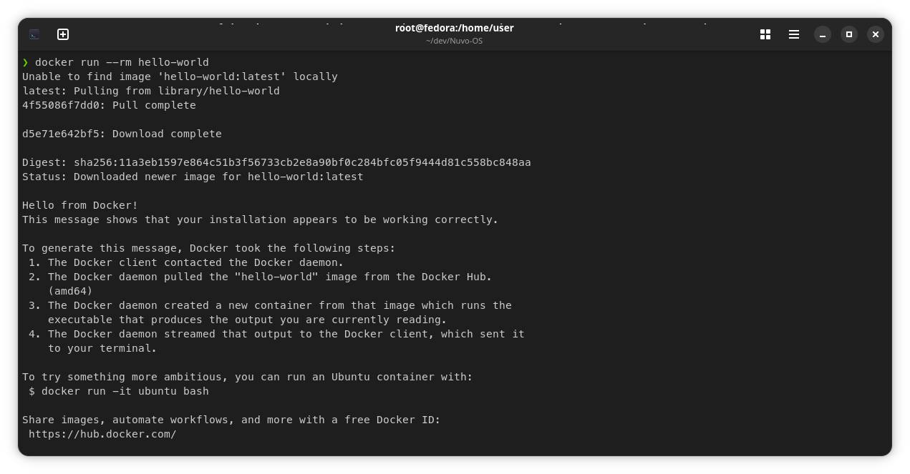
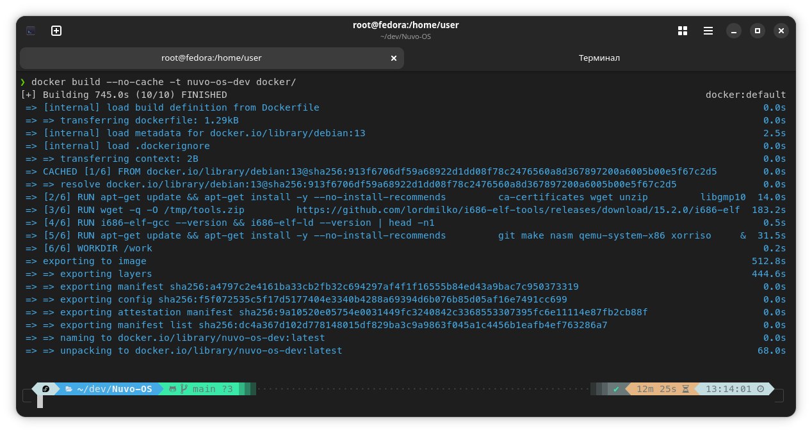
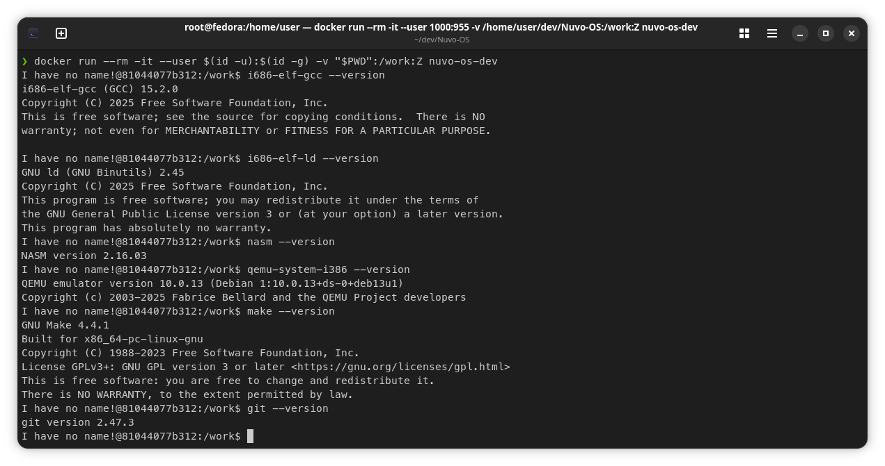

# Этап 000. Настройка окружения
Цель: научиться устанавливать и настраивать окружение для разработки операционной системы, применить знания на практике.

# 1. Описание этапа
Этот этап - отправная точка. Необходим он для правильной установки и настройки окружения, в котором будет разрабатываться операционная система. Без него следующие этапы невозможны.

# 2. Теоретическая часть
Окружение (с англ. Environment) - это набор инструментов, библиотек и настроек, необходимых для написания, сборки, отладки и запуска кода. В него входят компилятор, ассемблер, компоновщик, отладчик, система сборки и среда выполнения (эмулятор или реальное оборудование).

Разработка операционной системы отличается от разработки обычного приложения: компилятор хост-системы генерирует код под хост-ОС, а не под разрабатываемую систему. Поэтому для ОС применяется кросс-компиляция - сборка кода под целевую архитектуру с помощью отдельной цепочки инструментов (toolchain), независимой от хост-системы.

Основные компоненты окружения для разработки Nuvo-OS:
- кросс-компилятор и бинарные утилиты под целевую архитектуру (i686-elf-gcc с binutils), а также отладчик i686-elf-gdb;
- ассемблер NASM для загрузчика и ассемблерных вставок;
- эмулятор QEMU для тестирования системы без реального железа;
- xorriso для создания загрузочного ISO-образа;
- система сборки make и система управления версиями git.

Виды окружения:
1. Нативное - инструменты устанавливаются прямо в хост-ОС (рекомендуется Linux);
2. Виртуальная машина - изолированная гостевая ОС с настроенным окружением;
3. Контейнер (Docker) - изолированное окружение, запускаемое на хосте без установки инструментов в саму хост-систему.

Для Nuvo-OS выбран контейнер, так как он даёт одинаковые версии инструментов у всех участников проекта и не зависит от дистрибутива хоста.

Основные понятия Docker:
- Dockerfile - текстовое описание, из каких шагов собирается окружение;
- образ (image) - собранное по Dockerfile готовое окружение, неизменяемый шаблон;
- контейнер (container) - запущенный экземпляр образа;
- том (volume, `-v`) - каталог хоста, подключённый внутрь контейнера: репозиторий остаётся на хосте, а сборка выполняется внутри контейнера.

Кросс-компилятор можно собрать из исходников GCC и binutils (долго и требует множества зависимостей) или использовать готовые бинарные сборки. В проекте используется готовая сборка i686-elf-tools.

# 3. План
1. Подготовить хост-машину: установить Docker и проверить его работу контейнером hello-world.
2. Описать окружение в `docker/Dockerfile` (git, make, nasm, qemu-system-i386, готовый кросс-компилятор i686-elf-gcc с binutils, добавление в PATH) и собрать образ.
3. Запустить контейнер с подключением репозитория.
4. Проверить версии установленных инструментов (i686-elf-gcc, i686-elf-ld, nasm, qemu-system-i386, make, git).
5. Оформить отчёт со скриншотами выполненной работы.

# 4. Отчёт
*Весь показанный ниже отчёт воспроизводится на установленном Workstation образе Linux Fedora 44.*

## 1. Подготовка хост-машины

Хост: Fedora (Docker устанавливается на хост, весь тулчейн находится в контейнере).

```bash
sudo dnf install -y moby-engine
sudo systemctl enable --now docker
sudo usermod -aG docker $USER
newgrp docker
docker run --rm hello-world
```

Успешный запуск контейнера hello-world подтверждает, что Docker работает.
<div align="center">

</div>

## 2. Установка инструментов

Окружение описано в `docker/Dockerfile` (базовый образ Debian 13). В образ устанавливаются git, make, NASM, QEMU, xorriso и готовый кросс-компилятор i686-elf-tools 15.2.0 (GCC 15.2.0, Binutils 2.45, GDB 16.3). Архив проверяется по SHA256, каталог `/opt/cross/bin` добавляется в `PATH`.

```bash
docker build --no-cache -t nuvo-os-dev docker/
```

Сборка образа nuvo-os-dev завершена успешно.
<div align="center">

</div>

## 3. Запуск окружения

```bash
docker run --rm -it --user $(id -u):$(id -g) -v "$PWD":/work:Z nuvo-os-dev
```

Репозиторий монтируется в `/work`, поэтому файлы остаются на хосте.

## 4. Проверка версий

```bash
i686-elf-gcc --version
i686-elf-ld --version
nasm --version
qemu-system-i386 --version
make --version
git --version
```

Версии кросс-компилятора, ассемблера, эмулятора и вспомогательных инструментов внутри контейнера.
<div align="center">

</div>